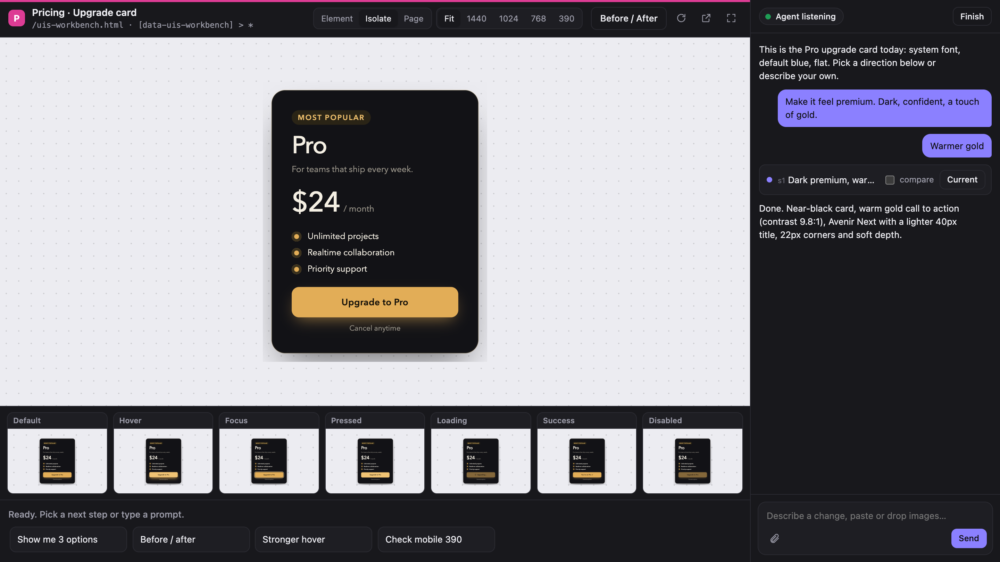

<h1 align="center">UI Studio</h1>

<h3 align="center">Your agent redesigns. You steer it, live.</h3>

<p align="center">
  
  <a href="https://github.com/mikolajpochec/agent-ui-studio/releases"></a>
  <a href="LICENSE"></a>
  <a href="https://github.com/mikolajpochec/agent-ui-studio/stargazers"></a>
</p>

<p align="center">
  <a href="#install"><strong>Install</strong></a> &nbsp;·&nbsp;
  <a href="#use"><strong>Use</strong></a> &nbsp;·&nbsp;
  <a href="#what-it-can-preview"><strong>What it can preview</strong></a> &nbsp;·&nbsp;
  <a href="#common-questions"><strong>FAQ</strong></a>
</p>

<p align="center"></p>

Point Claude Code at a button, a card, a section or a whole page, and it opens a design studio in its own window: your real component running in isolation, every UX state next to it, and a chat to steer the redesign while Claude edits the actual code.

## Install

Tell Claude Code:

> Install the UI Studio skill from https://github.com/mikolajpochec/agent-ui-studio

It sets everything up (asking before it installs [Bun](https://bun.sh), if you don't have it) and tells you when it's ready.

When a new release is out, the studio and Claude let you know; say "update UI Studio" to get it. See the [changelog](CHANGELOG.md) for what changed.

## Use

Start it with the slash command and say what to work on:

```
/ui-studio the Pro pricing card
```

or just ask in plain words, for example "let's redesign the settings save button in the studio". The studio window opens, and from then on you talk to Claude there:

- "Make it feel premium. Dark, confident, a touch of gold."
- "Warmer gold", sent while Claude is still working, or one click on a suggestion card
- "Show me 3 options", then **Use this** on the one you like

Click **Finish** (or close the window) when you're done. Claude removes everything studio-specific, and your main session gets a summary of what changed.

## What you get

- **Your real component, live.** Running in isolation on your dev server, not a mockup.
- **Every UX state** as live tiles next to it.
- **Steer while it works:** chat, live status and suggestion cards.
- **Live variants** side by side, plus a before/after slider.
- **Checkpoints and fullscreen.**

## What it can preview

| Project | Preview |
|---|---|
| Web apps with a dev server (Vite, Next, Nuxt, SvelteKit, Astro, Remix, Angular, Rails, Django, Laravel, Phoenix…) | Live, through your dev server |
| Components with Storybook stories | Live, the story |
| Plain HTML and CSS | Live, served from disk with reload on save |
| React Native with web support | Live, the web rendering |
| Native iOS, Android, Flutter | Device screenshots after each change (the only non-live mode) |

## Common questions

**Does it change my code?**
Yes, that's the point: Claude edits your real files while you watch. On Finish it deletes its workbench and any targeting attributes it added, so only the design changes stay.

**Can I go back?**
Every finished step is a checkpoint. Restore any of them from the chat, or compare it with the current version.

**What does it need?**
Claude Code, a Chromium-based browser (Chrome, Brave, Edge, Chromium or Vivaldi) and macOS or Linux. If [Bun](https://bun.sh) is missing, Claude offers to install it.

**Does anything leave my machine?**
Your code and designs don't. The studio is a local server bound to 127.0.0.1, and its window is a local browser window. The only outside request is a version check against GitHub's releases, at most once a day; set `UI_STUDIO_NO_UPDATE_CHECK=1` to turn it off.

**What if I close the window by accident?**
Closing it counts as Finish. Ask Claude to open the studio again with the same title and it picks up the session with its full history.

## License

[GPL-3.0](LICENSE)
